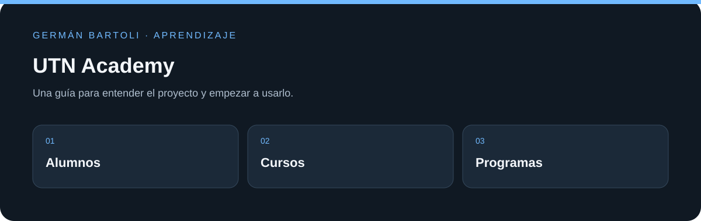

# UTN Academy

**Aplicación académica Java con interfaz web para administrar alumnos, cursos, inscripciones y programas descargables.**

[Empezar](#primeros-pasos) · [Mapa del repositorio](#mapa-del-repositorio) · [Autoría](#autoría-de-esta-documentación)

*Esquema de orientación; no representa una captura de la aplicación.*

## Primeros pasos

1. Abrí el proyecto web en NetBeans y revisá las bibliotecas y el servidor configurados en `nbproject/`.
2. Usá `UTNAcademia BD.txt` como referencia para preparar una base local; adaptá la conexión del proyecto a ese entorno.
3. Recorré los programas públicos y luego las pantallas administrativas de alumnos, cursos e inscripciones. Las capturas de abajo muestran el recorrido original.

## Entorno de aprendizaje

Este repositorio conserva ejercicios y versiones de su etapa de estudio. Revisá los archivos de proyecto para preparar el SDK, runtime o servidor correspondiente; esta actualización del README no migra dependencias ni acredita una ejecución reciente de todos los ejemplos.

## Referencia y detalles

En una academia de programación necesitan un software que les permita administrar la información relacionada a los alumnos y su estudio. Cada alumno puede inscribirse a uno o más cursos, pudiendo acceder a diversos descuentos según algunos criterios que determina la academia. Durante el cursado los alumnos deben rendir exámenes parciales y finales pero también deben desarrollar programas de distribución gratuita que luego son ofrecidos por la academia para que puedan ser descargados y probados por cualquier persona. Cada vez que alguien solicita una descarga el sistema debe contarla, para identificar cuáles son los programas preferidos.

La academia nos pide un sistema con interfaz web que permita a cualquier navegante leer información de la misma y descargar los programas que desarrollaron los alumnos. Por otro lado, el sitio debe tener una sección de login para administradores, en donde existan las siguientes opciones:

- Carga de programas. Cada programa publicado le pertenece al alumno que lo desarrolló, y puede estar habilitado o deshabilitado para ser descargado. Los programas deshabilitados no se deben mostrar en el listado público.
- ABMC (ALTA BAJA MODIFICACIÓN CONSULTA) de cursos.
- ABMC de alumnos
- Inscripción de los alumnos a los cursos. Al inscribir a un alumno, si tiene algún descuento se debe indicar el porcentaje del mismo.
- Sección reportes:
  - Total facturado por cada curso.
  - Sumatoria total de los descuentos realizados.
  - Listado de alumnos de algún curso seleccionado.
  - Listado de los 5 programas más descargados.
  - Listado de todos los alumnos que accedieron a algún descuento. Si un alumno tiene descuentos en más de un curso, sólo debe aparecer una única vez en el listado.

## Imagenes

- Inicio (Admin)

## Programas

.png)

## Consultas

- Top 5 Programas

- Alumnos por curso

<!--
- Inicio

- Login

- Login Error

-->

## Miembros

- German Bartoli - [LinkedIn](https://www.linkedin.com/in/bartoligerman497/)

## Mapa del repositorio

La rama contiene documentación. No hay una aplicación para instalar.

## Autoría de esta documentación

Repositorio mantenido por [Germán Bartoli](https://github.com/GermanBartoli). Guía revisada y actualizada con **Codex**, coautor de esta actualización documental. Los autores, colaboradores, licencias y recursos de terceros conservan sus créditos originales.

Los commits de esta revisión incluyen `Co-authored-by: Codex <noreply@openai.com>`; esta atribución no modifica la autoría del historial anterior.
